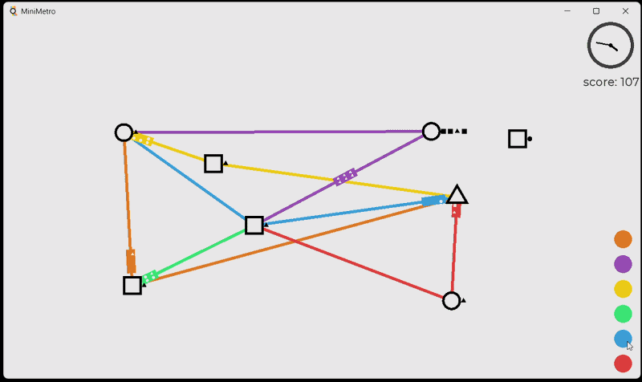
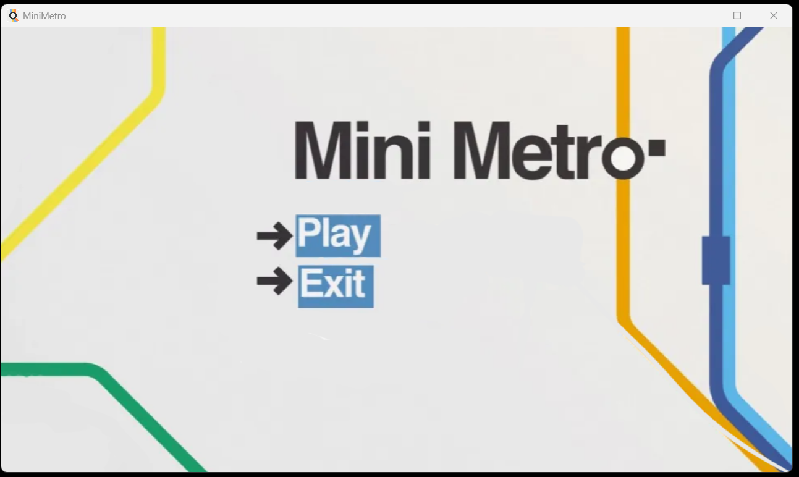

<h1 align="center">MiniMetro</h1>

<p align="center">
  Joc de simulare a unei rețele de metrou, scris în C++ modern: construiești linii, conectezi stații și transporți pasageri cât mai eficient.
</p>

<p align="center">
  
  
  
  
</p>

<p align="center">
  
</p>

## Despre proiect
MiniMetro este o implementare în C++ a unui joc de gestionare a unei rețele de metrou, inspirat de Mini Metro. Orașul crește în timp: apar stații noi, iar pasagerii vor să ajungă la stații de forma lor. Jucătorul trasează linii și folosește trenurile disponibile ca să-i ducă la destinație înainte ca stațiile să se aglomereze.

Este proiectul final la cursul de **Programare orientată pe obiecte** și combină tot ce s-a învățat în semestru: ierarhii de clase, template-uri, smart pointers și design patterns, într-o arhitectură cât mai apropiată de un proiect real.

## Cerințele proiectului
Proiectul a avut ca scop un cod generic, sigur din punct de vedere al memoriei și bine structurat. Cerințele principale au fost:

- **Structura claselor:** minim 5 clase, dintre care minim 3 legate prin moștenire, cu encapsulare strictă (fără atribute publice)
- **Template-uri:** o clasă template proprie, utilă funcțional, minim 2 funcții template, instanțiate cu cel puțin 2 tipuri diferite, plus o specializare sau un constraint (`static_assert`, `if constexpr` sau `concepts`)
- **Smart pointers:** toată alocarea dinamică prin `unique_ptr`, `shared_ptr` și `weak_ptr`, cu `make_unique` / `make_shared` și fără `new` direct
- **Design patterns:** minim 2, folosite efectiv pentru o problemă reală din proiect
- **Meniu interactiv** care demonstrează funcționalitățile, polimorfismul și pattern-urile
- **Tratarea erorilor** cu `try` / `catch` și excepții proprii derivate din `std::exception`
- **STL și C++ modern:** containere, algoritmi, `std::function`, `std::optional`, regula celor 0 / 5

## Cum sunt îndeplinite

| Cerință | Implementare |
|---|---|
| Moștenire și polimorfism | Ierarhia `Station` → `CircleStation`, `SquareStation`, `TriangleStation` |
| Clasă template proprie | `Repository<T>` (`Repository.h`) <!-- DE VERIFICAT: ce stochează și cu ce tipuri e instanțiată --> |
| Funcții template, specializare / constraint | <!-- DE VERIFICAT: numele funcțiilor și constraint-ul folosit --> |
| Smart pointers | <!-- DE VERIFICAT: unique_ptr pentru stații, shared_ptr / weak_ptr unde e cazul --> |
| Pattern **Factory** | `Stationfactory` creează stațiile după tip |
| Pattern **Observer** | `IGameObserver` notifică componentele la schimbările de stare |
| Excepții proprii | <!-- DE VERIFICAT: numele claselor de excepții --> |
| Configurare | `GameConfig` citește parametrii din `config.txt` |

## Capturi de ecran

<p align="center">
  
</p>
<p align="center"><em>Meniul principal</em></p>

## Funcționalități
- **Stații de mai multe tipuri:** cerc, pătrat, triunghi
- **Linii de metrou** pe care circulă trenuri
- **Pasageri** cu destinații bazate pe tipul stației
- **Motor de simulare** care actualizează starea jocului
- **Randare separată** de logica jocului
- **Parametri configurabili** prin `config.txt`
- <!-- DE VERIFICAT: condiția de pierdere, scor, interacțiunea cu mouse-ul -->

## Arhitectură

| Componentă | Rol |
|---|---|
| `Station`, `CircleStation`, `SquareStation`, `TriangleStation` | Ierarhie de stații |
| `Stationfactory` | Creează stațiile (Factory) |
| `MetroLine`, `LineSlot` | Liniile de metrou și pozițiile lor |
| `Train`, `Passenger` | Entitățile mobile din joc |
| `SimulationEngine` | Logica și evoluția în timp a simulării |
| `IGameObserver` | Notificarea componentelor despre schimbări (Observer) |
| `GameRenderer` | Desenarea jocului pe ecran |
| `GameConfig` | Încărcarea setărilor din `config.txt` |
| `Repository` | Stocare generică a obiectelor (template) |

## Tehnologii
- **Limbaj:** C++ <!-- DE VERIFICAT: standardul, ex. C++20 -->
- **Build:** CMake
- **Grafică:** <!-- DE VERIFICAT: SFML / SDL / Qt / altă bibliotecă -->
- **Concepte:** OOP, moștenire, polimorfism, template-uri, smart pointers, design patterns, excepții, STL

## Cum rulezi proiectul
```bash
git clone https://github.com/daria-stamin/MiniMetro.git
cd MiniMetro
cmake -B build
cmake --build build
./build/MiniMetro
```
<!-- DE VERIFICAT: numele executabilului și bibliotecile necesare -->

## Ce am învățat
- Proiectarea unei aplicații C++ cu ierarhii de clase și polimorfism
- Programare generică cu template-uri
- Gestionarea sigură a memoriei cu smart pointers
- Aplicarea design pattern-urilor (Factory, Observer)
- Tratarea erorilor cu excepții proprii
- Separarea logicii de randare și configurare


---
<sub>Proiect educațional, inspirat de jocul Mini Metro. Nu este afiliat cu dezvoltatorii originali.</sub>
